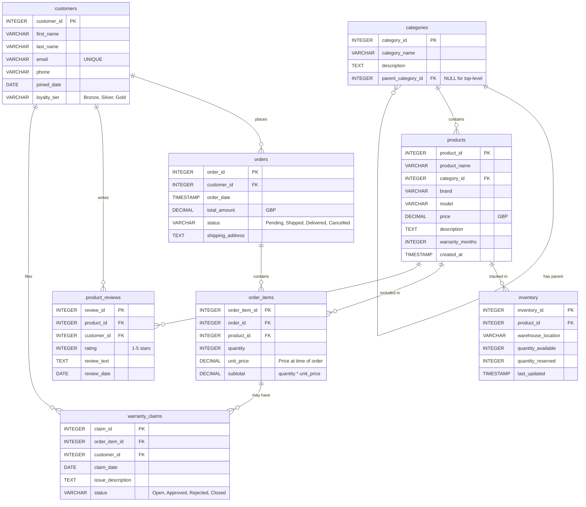

# TechWiz Electronics - Entity Relationship Diagram

This diagram shows the database schema for the TechWiz Electronics e-commerce system.



## Table Descriptions

### categories
Hierarchical product categorization system. Supports nested categories through the `parent_category_id` self-referencing foreign key.

### products
Core product catalog with pricing, warranty, and descriptive information. Each product belongs to one category.

### inventory
Tracks stock levels across multiple warehouse locations. Separates available quantity from reserved (pending orders).

### customers
Customer profiles with contact information and loyalty program tier tracking.

### orders
Customer order history with status tracking and shipping information.

### order_items
Line items for each order, capturing quantity and price at the time of purchase.

### product_reviews
Customer feedback and ratings for products. Supports 1-5 star ratings with optional text reviews.

### warranty_claims
Tracks warranty claims linked to specific order items, allowing for issue resolution and status monitoring.

## Key Relationships

1. **Products → Inventory**: One product can have stock in multiple warehouses (one-to-many)
2. **Customers → Orders**: One customer can place multiple orders (one-to-many)
3. **Orders → Order Items**: One order contains multiple products (one-to-many)
4. **Products → Order Items**: One product can appear in multiple orders (one-to-many)
5. **Order Items → Warranty Claims**: One order item can have multiple warranty claims over time (one-to-many)
6. **Categories → Products**: One category contains multiple products (one-to-many)
7. **Categories → Categories**: Self-referencing for hierarchical structure (one-to-many)

## Sample Queries

Here are some useful queries for working with this schema:

### Get all products with current inventory
```sql
SELECT
    p.product_name,
    p.brand,
    p.price,
    i.warehouse_location,
    i.quantity_available
FROM products p
JOIN inventory i ON p.product_id = i.product_id
WHERE i.quantity_available > 0
ORDER BY p.product_name;
```

### Find top-rated products
```sql
SELECT
    p.product_name,
    AVG(pr.rating) as avg_rating,
    COUNT(pr.review_id) as review_count
FROM products p
LEFT JOIN product_reviews pr ON p.product_id = pr.product_id
GROUP BY p.product_id, p.product_name
HAVING COUNT(pr.review_id) >= 2
ORDER BY avg_rating DESC, review_count DESC;
```

### Get customer order history
```sql
SELECT
    c.first_name,
    c.last_name,
    o.order_id,
    o.order_date,
    o.total_amount,
    o.status
FROM customers c
JOIN orders o ON c.customer_id = o.customer_id
WHERE c.customer_id = 1
ORDER BY o.order_date DESC;
```

### Check warranty claim status
```sql
SELECT
    wc.claim_id,
    c.first_name,
    c.last_name,
    p.product_name,
    wc.claim_date,
    wc.issue_description,
    wc.status
FROM warranty_claims wc
JOIN customers c ON wc.customer_id = c.customer_id
JOIN order_items oi ON wc.order_item_id = oi.order_item_id
JOIN products p ON oi.product_id = p.product_id
WHERE wc.status IN ('Open', 'Approved')
ORDER BY wc.claim_date DESC;
```

## Database Statistics

Based on the seed data:
- **6** product categories
- **40** products
- **61** inventory records across 3 warehouses (London, Manchester, Online)
- **25** customers
- **30** orders
- **50** order line items
- **35** product reviews
- **8** warranty claims

## Notes for Implementation

1. **Referential Integrity**: All foreign key constraints ensure data consistency
2. **Indexes**: Performance-critical columns have indexes (see schema.sql)
3. **Timestamps**: Automatic timestamps for tracking record creation and updates
4. **Constraints**: CHECK constraints ensure data validity (e.g., ratings 1-5)
5. **Loyalty Tiers**: Bronze, Silver, Gold tiers affect customer support priority
